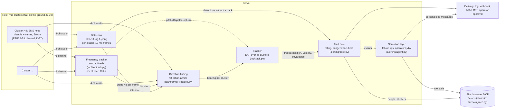
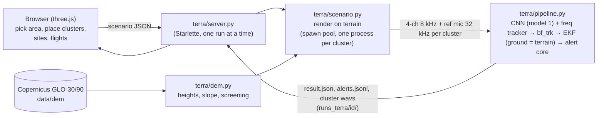

# ARCHITECTURE.md: how the system fits together and how it was built

This is the map of the whole system:
- what each part does, and the code it lives in;
- how data moves between the parts;
- how each part was built and checked;
- the machines it runs on.

The reasoning and maths behind each choice are in **design.md**; decision numbers (D-xx) and sections refer to it. To set things up and check them, follow **AGENTS.md**.

**Status (2026-10-24):** every software stage exists and runs end to end, but only on simulated sound and public recordings.

| Not done yet | Where it's planned |
|---|---|
| Mic cluster hardware | design 9.6, D-37 |
| Field test with the owner's flyovers | design 14.7 |
| Doppler that helps the tracker: pair frequency differences, not one shared pitch state | results/chain_v2/README.md |
| A mic connected for live input (the code exists) | README section 9 |
| Connection to the real Zetaris | needs access details |

---

## 1. The system in one picture

The target deployment: clusters of 4 microphones on the ground around a site, a server that detects, locates and tracks drones, and an alert layer that tells people what to do.

The design rules, and where each is set:

| Rule | Where |
|---|---|
| Train only on simulated sound; real recordings are for testing only | D-21, D-25 |
| Flat clusters on the ground: they give a good compass bearing but poor elevation, so the tracker gets only a coarse height | D-30, D-38 |
| Alerts are decided by fixed, tested logic | `alerting/core.py` |
| The language model only words messages and answers questions, and every number it writes is checked | design 13.6.6 |

## 2. What exists, by stage

| Stage | Code | Status | Design |
|---|---|---|---|
| Scene simulator: drones, confusers, propagation, labels | `sim/` | Built; 6,400 training scenes plus localisation scenes rendered | 14.6 |
| Drone detector (CNN) | `cnn/` | Model 1 (`B_logf`) is the default. Models A, C and 2 are comparisons | 5.7–5.11 |
| Multi-cluster scenes and direction finding | `sim/layouts.py`, `loc/render.py`, `loc/doa.py`, `loc/run_doa.py` | Built and measured on simulated scenes and on real IDMT array recordings | 13.5 |
| Frequency tracker | `loc/freqtrack.py`, `loc/eval_freq.py` | Built (rebuilt; the original code was lost). 73% of audible frames locked, 0.15% pitch error | 5.2, 6, `results/freqtrack/` |
| Tracker-guided beamformer (`bf_trk`) | `loc/run_doa.py --trkcomb` | Built. Replaces the oracle comb: tracking as good as with the true shaft rates | `results/chain_v2/` |
| Tracker (EKF) | `loc/track.py` | Built and tested (NEES). Optional Doppler pitch state, off by default because it hurt on real scenes | 13.2, 13.5, `results/chain_v2/` |
| Live input (sound card or replay) | `live/run.py` | Built; replays verified. No mic on the dev desktop yet | README section 9 |
| Rating, danger zone, alert tiers, delivery | `alerting/rating.py`, `danger.py`, `core.py`, `delivery.py` | Built and tested; tabletop and replays | 5.12, 13.3, 13.6 |
| Nemotron layer and site data over MCP | `alerting/agent.py`, `sitedata.py`, `sitedata_mcp.py`, `config.py` | Built. Runs Nemotron 3.5 Lightning on Anna's PC. Zetaris is a stand-in | 13.4, 13.6 |
| UAE terrain tool (live demo) | `terra/` | Built. Full chain on real UAE terrain in 3D | README "Live demo" |
| Cluster hardware and firmware | — | Planned | 7, 9.6 |

## 3. The parts in detail

### 3.1 Scene simulator (`sim/`)

It renders what microphones hear while drones and drone-like sounds move past, in pascals, with frame labels.

- **Sources** (`sim/sources.py`):
  - **Electric multirotors:** each rotor's blade-pass harmonics plus motor whine. Rotor speeds come from flight dynamics: thrust balances gravity, acceleration and drag, and the rear rotors spin faster in forward flight.
  - **Two-stroke engines:** firing pulses with resonance, an optional muffler, misfires, and propeller tones.
  - **Confusers:** chainsaws, blowers, mopeds, vehicles, aircraft, fans, mains hum, insects, birds.
  - **Diffuse beds:** wind in trees, traffic, urban, quiet rural, and rain (rain is held out of training).
- **Drone classes** (D-27, design 4.4): FPV 5–7", electric 7–12", two-stroke multirotor and two-stroke fixed-wing.
- **Propagation** (`sim/acoustics.py`):
  - **Delay:** each sample's emission time is solved exactly, so Doppler comes out naturally, and it is read with a fractional delay.
  - **Spreading:** 1/r.
  - **Ground echo:** an image source with a reflection coefficient.
  - **Air absorption:** ISO 9613-1, applied per STFT frame.
  - **Levels:** set in dB(A).
- **Labels** (`sim/scene.py: frame_labels`, label version `snr_lines2`):
  - **Positive:** at least two separate tone regions stand ≥ 6 dB above everything else.
  - **Negative:** none stands above 0 dB.
  - **Ignored:** anything in between.

  Plain loudness made a poor label: a drone can be clearly tonal at −20 dB broadband SNR (design 5.8).
- **Renderer** (`sim/render.py`):
  - **Parallel:** seeds are deterministic, so a scene renders identically from its seed (bit-identical on the same platform). AGENTS.md checks this with `scripts/manifest.py`.
  - **Splits:** by seed. `test_heldout` uses unseen rotor counts, higher tip speeds and rain.
- **Output per scene:** 32 kHz FLAC plus `.npz` labels plus `.json` metadata. `sim_v1` holds 6,400 scenes, 26 GB.

**How it was built.**
- **Design decisions:** the owner chose simulation-only training, whole flyover scenarios, and the drone classes. I designed the physics (design 14.6).
- **Bug fixes from code review:**
  - the front end was trainable by mistake (it is now frozen);
  - reads fell outside the audio buffer;
  - label regions were counted twice when a tone straddled two bins;
  - flights stopped dead when they should continue at their final velocity.
- **Lint:** an automatic ruff hook checks every edited file.
- **Checks:** the simulator was compared with real recordings in design 5.11, and the gaps are listed in design 14.5.

### 3.2 Drone detector (`cnn/`)

- **Model** (`cnn/model.py`):
  - **Base:** PANNs **CNN14** (`Cnn14_DecisionLevelMax`, pretrained on AudioSet, mAP 0.385; vendored MIT code in `cnn/panns_*.py`).
  - **Head:** a new 3-class head, `drone_electric`, `drone_engine` and `ground_engine`, giving a probability every 10 ms.
- **Front end** (`logf`, D-19/D-20): a mel filterbank bent at 50 Hz, so it is spaced logarithmically over the whole drone range, with n_fft 4096 at 32 kHz and 64 bands from 50 Hz to 14 kHz. Its normalisation (bn0) is relearned, because the bands cover different frequencies from AudioSet's.
- **Training** (`cnn/train.py`, `cnn/data.py`):
  - **Input:** random 10 s crops, biased towards labelled frames.
  - **Augmentation:** random gain, polarity and a random tilt in frequency response, to stand in for unknown mics.
  - **Loss:** masked binary cross-entropy, so ignored frames don't count, with positive weights 2/3/3.
  - **Stage 1:** 1,500 steps training the head with the body frozen.
  - **Stage 2:** 15,000 steps training everything at learning rate 1e-4, cosine schedule.
- **Evaluation** (`cnn/evaluate.py`): frame precision, recall and F1; detection probability against distance; false alarms per hour on scenes with no drone.
- **Inference** (`cnn/infer.py`): runs on any WAV and writes `.detections.csv` and `.png`.

| Model | What | Validation mean F1 | Use |
|---|---|---|---|
| **B_logf (model 1)** | CNN14, log-f front end | 0.914 | **Default** everywhere |
| A_mel | CNN14, stock mel front end | ~0.90 | Comparison |
| C_small | ~1.2M-parameter CNN and GRU, trained from scratch | ~0.89 | Comparison, small enough for embedded use |
| M2_logf_comb (model 2) | B plus two fixed channels: the whitened spectrum and a harmonic-comb score over 64 candidate rates (20 Hz–2 kHz). It enters through a zero-initialised conv, so it starts identical to B | 0.912 | Experiment: about ⅓ of B's engine false alarms, but a shorter detection range at 0.5 |

**How it was built.**
- **Base model:** the owner chose to fine-tune CNN14 on a log-frequency spectrogram (design 5.7, 5.8).
- **Hardware split:**
  - Anna's RTX 3080 trained A and B (and later model 2) at batch 16, with 3 data-loading workers, below-normal priority and a 240 W cap.
  - The desktop's RTX 4060 Ti trained C.
- **Testing after training:**
  - a failure analysis by slice, robustness and sweeps (design 5.10, `analysis/`);
  - real-recording tests on IDMT, Svanström and ESC-50 (`results/real_world/REAL_TESTS.md`).
- **Real-world result:** real drones are detected out to about 100 m, but everyday non-drone sounds trigger false alarms. UPGRADES.md ranks the fixes.

### 3.3 Localisation: clusters, direction finding, tracking (`sim/layouts.py`, `loc/`)

- **Cluster geometry** (`sim/layouts.py`): a flat cluster is an equilateral triangle with 20 cm sides plus a centre mic, 3 cm above the ground (D-30, adopted). The tetrahedron (D-07, superseded) is kept for comparison.
- **Field layouts:** 5 clusters on a 100 m or 150 m square, or 3 in a line.
- **Scenes** (`loc/render.py`): the training scenes heard at every mic of a layout. Each cluster gets 4-channel 8 kHz audio, plus truth at 10 Hz: the direction at emission time, range, radial speed and per-rotor shaft rates.
- **Direction finding** (`loc/doa.py`, torch on the GPU):
  - **srp:** SRP-PHAT-β across the 6 mic pairs.
  - **ls:** least squares on the pair delays, cheap enough for an ESP32.
  - **bf (used):** a reflection-aware beamformer. Its steering vector includes the ground echo:

    $$a_i = e^{jk(x_i u_x + y_i u_y)}\left(e^{jk z_i u_z} + R\, e^{-jk z_i u_z}\right)$$

    with R = 0.75, β = 0.5, over 100–860 Hz.

    Pairwise methods are biased by the echo by 3–40°; bf stays within 0.1–2° on clean signals.
- **Tracker** (`loc/track.py`): an extended Kalman filter.
  - **Model:** constant velocity, with process noise q_acc = 6.
  - **Measurements:** in the tangent plane of the predicted direction. For flat clusters the elevation noise is scaled up as σ_u / sin(el).
  - **Emission-time correction:** the measured direction is where the drone was when the sound left it.
  - **Association and track management:** χ² gate 13.8, global nearest neighbour per cluster, a new track starts where two rays nearly meet, and duplicate tracks are merged.
  - **Terrain:** an optional ground-height function supports the terrain tool.

| Result | Value |
|---|---|
| Direction error (bf), tetrahedron | 4.9–6.5° median |
| Direction error (bf), flat | 12° median |
| Comb-guided bf with true shaft rates | 1.4° (up to 860 Hz) / 2.5° (up to 2 kHz) |
| Tracker-guided bf (`bf_trk`), flat, 120 scenes | 5.3° (up to 860 Hz) / 3.0° (up to 2 kHz) median; heavier tail than the oracle |
| EKF on `bf_trk`, flat, single drone | 5.9 m horizontal, 5.1 m height, 3.5 m/s velocity median |
| Real IDMT array, azimuth vs GPS | 8.5° |
| 100 m vs 150 m spacing | No difference |

Details in design 13.5 and `results/loc_v1/`.

**How it was built.** These came out of the measurements:
- β = 1 lost the tones, so β = 0.5 is used.
- The ground echo broke pairwise GCC, which led to the reflection-aware beamformer.
- The CPU was too slow, so direction finding moved to torch on the GPU, with steering tables built in chunks to fit in memory.
- Comparisons were made on paired scenes only.

The tracker's consistency is checked by NEES tests (`tests/test_track.py`). After that, the owner chose all-flat clusters with coarse height (D-30, D-38).

### 3.3a Frequency tracker and chain v2 (`loc/freqtrack.py`, `loc/run_doa.py --trkcomb`)

The tracker finds each cluster's harmonic tone (up to two) every 0.1 s without knowing the drone:

1. **Spectrogram:** Hann 0.4 s, hop 0.1 s, NFFT 16384 at 8 kHz (0.49 Hz bins), 30–3900 Hz.
2. **Whitening:** power smoothed over 3 frames, minus a ±40 Hz running mean, clipped to 0–30 dB.
3. **Comb score** on a 0.1% log grid of candidate fundamentals from 40 to 1300 Hz:
   $$\text{score}(f_0) = \sum_{k=1}^{K} 0.6^{k-1}\big[S(kf_0) - 0.25\,S((k-\tfrac12)f_0)\big]$$
   The gap term stops a single strong line, or noise, from scoring like a comb.
4. **Viterbi path** with a "no tone" state (score 5), a 2%-per-frame jump limit, and a switch cost.
5. **Second tone:** notch the first tone's harmonics (±6 Hz) and repeat.
6. **Refine:** a parabolic peak per harmonic, then a weighted least-squares f0. It is kept only within 0.3% of the comb's pitch.

**Uses.**
- The beamformer is weighted onto bins within 4 Hz of the tracked harmonics (`bf_trk`, replacing the oracle comb).
- The tone is a trigger, but only together with the CNN: on its own it fires in 61% of frames with no drone audible.
- Doppler is optional in the EKF: state 8 = [p, v, ln f0, d ln f0/dt] with
  $$h_k = \ln f_0 - \text{lag}_k\,\dot{(\ln f_0)} - \ln(1 + \dot r_k / c)$$
  It is off by default; see `results/chain_v2/README.md` for why and for the next design.

**How it was built.**
- **Max filters:** wide max filters on the comb teeth raised the noise floor by 3–8 dB at the gaps, so they were dropped.
- **Tuning:** harmonic decay, gap weight and the null score were tuned on 40 tetra scenes, then checked on the 120 flat ones.
- **Pitch rate:** in the synthetic tests, the pitch-rate state was needed. Without it, emission-time differences between clusters made RPM changes look like vertical speed.
- **Refine bug:** in 30 of 1.1M frames the refine step gave nonsense pitches, as low as −209 Hz. It was caught by a NaN warning in the full run, fixed, and pinned by a test.

### 3.4 System layer: rating, danger zone, alerts (`alerting/`)

- **Rating** (`rating.py`, D-32, D-38): likelihood = p_cnn × f_height × f_speed × f_persist.
  - **Levels:** likely ≥ 0.5, low < 0.15.
  - **Height:** with no usable height the alert is "unrated" and is never called a ground source.
- **Danger zone** (`danger.py`, D-35): the probability that the predicted position is inside a site's radius:

  $$q(\tau) = \mathrm{ncx2.cdf}\big((R/\sigma)^2;\ 2,\ (d/\sigma)^2\big)$$

  - **Prediction noise:** q_acc 0.5, gentler than the tracker's 6, so a drone flying straight in still counts.
  - **Thresholds:** threatened when q ≥ 0.2 within 120 s. "On course" when the mean path passes within R.
- **Core** (`core.py`): advisory, on course, take cover, evacuate and all clear, with fixed gates.
  - **Take cover:** ≥ 10 updates and σ ≤ 30 m.
  - **Evacuate:** ≥ 20 updates, a reachable shelter, and operator approval, unless the site is threatened with under 60 s to go.
  - **Repeats:** messages repeat only on escalation or every 30 s.
  - **Speed:** under 1 ms per update.
- **Delivery** (`delivery.py`): log, print, webhook, an operator approval queue, and ATAK Cursor-on-Target events.
- **Nemotron layer** (`agent.py`): it uses an OpenAI-compatible endpoint and reads the site data over MCP (`sitedata_mcp.py`), with the tools `people_in_zone`, `nearest_shelter`, `list_shelters`, `list_sites` and `get_group`.
  - **Order of work:** facts first, then at most 6 rounds of tool calls and a final answer.
  - **Number check:** every number must appear in the facts or the tool results; probabilities may be rescaled (×100, /60).
  - **Unit check:** seconds against minutes.
  - **Name check:** only shelters, sites and groups that exist.
  - **Time check:** no walking advice when the shelter can't be reached in time.
  - **Unicode clean-up:** special spaces and dashes are normalised.
  - **Failure rules:** a public message that fails a check is dropped, and the core's template stands. Operator answers that fail are shown with the doubtful numbers flagged.
- **Config** (`config.py`): `LLM_BASE_URL`, `LLM_API_KEY`, `LLM_MODEL` and `SITE_MCP`, from the environment or `~/.config/audiodrone/alerting.env`, which is outside git.

**How it was built.** The replays exposed problems that shaped the design:
- A widened radius applied from "now" gave a false "over it now" (scene L20000014). That led to the probability form.
- Using the tracker's process noise for prediction missed a drone flying straight in. That led to the gentler q_acc 0.5 and the "on course" tier.
- A new track's large uncertainty set off take-cover. That led to the update and σ gates.
- Nemotron Mini (4B) invented shelters and turned seconds into minutes. That led to the name and unit checks.
- Nemotron 3.5 Lightning (30B) passes the checks.

### 3.5 UAE terrain tool (`terra/`)

A browser tool that runs the whole chain on real UAE terrain. It is the live demo (README "Live demo"; AGENTS.md step 7).

- **Terrain:** Copernicus DSM tiles are resampled to a local east/north metre grid around the chosen point. The DSM includes buildings.
- **In the sound model:**
  - **Heights:** cluster heights come from the DEM.
  - **Flights:** they follow the terrain (smoothed over about 3 s, as an autopilot would) or hold a fixed altitude.
  - **Ground echo:** it is mirrored in the local ground plane, fitted within 20 m.
  - **Screening:** hills cut the sound by single knife-edge diffraction (ITU-R P.526), with v = g√(f/c) per frame and the loss capped at 25 dB (ISO 9613-2).
- **Detection is the real CNN.** Earlier replays used a stand-in, p = 0.9 whenever the drone was audible.
- **Chain v2 (default):** the frequency tracker guides the beamformer wherever it holds a tone. `"chain": "v1"` gives the plain beamformer, and `"doppler": true` adds the opt-in Doppler state.
- **Speed:** a 2–3 minute flight with 5 clusters takes 30–70 s.
- **Limits:** one diffracting edge per path; no echoes off hillsides.

**How it was built.**
- **Changes to existing code:** two options were added to the propagation function (an explicit image mic and an extra loss term) and a ground-height option to the tracker. Their defaults are bit-identical to before, which `tests/test_terra.py` checks.
- **A bug found in testing:** a driver script without a `__main__` guard hung the spawn pool, so AGENTS.md has a ground rule for it.
- **UI checks:** the page was driven in headless Chrome with Playwright. That found that the hidden results band still showed, because `display: grid` overrode `hidden`. Bearings are drawn level because flat clusters' elevation is unreliable.

## 4. Data and file formats between stages

| Producer → consumer | Format |
|---|---|
| `sim/render.py` → `cnn/` | `data/sim_v1/<split>/<name>.flac` (32 kHz mono, 24-bit, full scale 120 dB SPL), `.npz` (`snr_lines/<cat>`, `bands/<cat>`, `frame_t`, drone range and BPF), `.json` (all scene parameters, `labels: snr_lines2`) |
| `cnn/train.py` → everything | `runs/<run>/best.pt` (state dict). Published as `models/*_best.pt` with `SHA256SUMS` in GitHub release `models-v0.5`; `scripts/setup.sh` downloads and verifies them |
| `loc/render.py` → `loc/run_doa.py` | `data/loc_v1/<config>/L<seed>.c<k>.flac` (4-ch 8 kHz per cluster), `.truth.npz` (per drone and cluster at 10 Hz), `.json` (with `centres`, `cluster`, `mount`) |
| `loc/freqtrack.py` (via `loc/eval_freq.py`) → `bf_trk`, tracker | `.freq.npz`: `c<k>/f0`, `c<k>/f0_fine`, `c<k>/score`, `c<k>/n_harm` (frames × 2 tones; NaN or 0 where there is no tone) |
| `loc/run_doa.py` → tracker, scoring, replay | `.doa.npz`: `<method>/c<k>/u` (frames × 3 unit vectors), `<method>/c<k>/coh` |
| tracker → alert core | `TrackSnapshot(id, state[8], P[8×8], n_upd, n_clusters, p_cnn, detected_s, duty)`. The alert layer reads only `[:6]` (position, velocity). Plus `Detection(cluster, p_cnn, detected_s, duty)` |
| `live/run.py` → screen and log | One JSON line per update: `t`, `p_drone`, `p_ground`, `tone`, `pitch_pct_s`, bearing |
| alert core → delivery and Nemotron | Event dicts: `t`, `tier`, `to`, `text`, `source`, `numbers`. Logged as JSON lines |
| `terra/server.py` ↔ browser | Scenario JSON (format in `terra/scenario.py`); result JSON with per-frame truth, CNN probability, bearings, screening, tracks, alerts and summary |

**Coordinates everywhere:** x east, y north, z up, in metres. The local frame is centred on the field (or, in the terrain tool, on the chosen point). Azimuth is measured from +x towards +y. Elevation is above the horizontal.

**Rates:** CNN 100 frames/s. Direction finding, tracker and alerts 10 Hz.

## 5. Where it runs (development setup)

| Machine | Role |
|---|---|
| Linux desktop (RTX 4060 Ti 8 GB, 16 cores, 31 GB) | Development, rendering, the small model, direction finding, the terrain tool server, the alert layer. Heavy untested jobs run under `systemd-run` memory and CPU limits |
| Anna's PC (Windows, RTX 3080 10 GB, shared) | CNN14 training (A, B, model 2) and half the rendering, all inside `C:\Users\pc\Joseph AI`. Low priority, a 240 W GPU cap and at most 3 data-loading workers. Jobs run as hidden scheduled tasks, because console windows get closed. It also serves **Nemotron 3.5 Lightning 30B-A3B** through Meterless Nightshift's bundled llama.cpp server (localhost only, with an API key) |
| SSH tunnel (`nightshift-tunnel` user unit) | Desktop 127.0.0.1:18089 → Anna's llama-server, and 18088 → Nightshift's own API |
| "bigboy" disk (NTFS, on the desktop) | Bulk data: localisation scenes and the UAE elevation tiles, linked into `data/` |
| GitHub `Quailworker/audiodrone` (private) | Code, docs and reference results. Model weights go in releases |

Scripts used across the two PCs are kept in `scripts/two_pc/` as a record.

## 6. Build history

| Date | Step | Commits |
|---|---|---|
| 2026-10-22 | **Design.** The owner's design.md (v0.3, D-01 to D-23): drones detected by their evenly spaced tones, ground mic clusters, a CNN, a Kalman filter. The CNN plan was reviewed and the CNN14 bn0 layout checked against PANNs | 6b9068d, bed87cb, 0f58b36 |
| 2026-10-22 | **Decisions for v0.4:** fine-tune CNN14 on a log-f spectrogram; simulation-only training; the owner's flyovers as the test; detection only; three drone classes; whole-scenario rendering; mics on the ground | fdb8122 |
| 2026-10-22 | **Simulator and CNN code.** Multi-tone labels, a small from-scratch CNN as a baseline, lint and review fixes. Rendering split across both PCs, CNN14 training on Anna's PC | 7a910f6 … 0c589f5 |
| 2026-10-23 | **v0.5 models (A, B, C).** Replication guide, test environment, AGENTS.md, release `models-v0.5` | 02de68d, c709949 |
| 2026-10-23 | **Finding the gaps.** Failure analysis of B (design 5.10), real-recording tests and UPGRADES.md, theory vs results (v0.6), the owner's scope decisions and the rating (v0.7), alerting with Nemotron and the danger zone (v0.8), ESP32 nodes (v0.8.1), NEXT_STEPS.md | 8940528 … b2aa54d |
| 2026-10-23 | **Phase 1 localisation.** Multi-cluster rendering, direction finding, EKF, scoring, the real IDMT check (design v0.9, 13.5) | 2110f9a, f8c1e2f, 86c8d12 |
| 2026-10-23 | **All flat (D-30 adopted), coarse height (D-38).** System layer: rating, danger zone, alert core, delivery, Nemotron layer, site data over MCP | c71b778, 7b340e4 |
| 2026-10-24 | **Nemotron 3.5 Lightning** on Anna's PC through Nightshift's bundled server and an SSH tunnel; fixes to the Nemotron checks | aa1e840 |
| 2026-10-24 | **Model 2** (frequency-tracker channels) trained; not adopted. **UAE terrain tool** (live demo) | d667609, 83bd94d |
| 2026-10-24 | **ARCHITECTURE.md** | 4f119a1 |
| 2026-10-24 | **Frequency tracker rebuilt**; tracker-guided beamformer (chain v2, default in terra); Doppler EKF state (opt-in); live input (`live/`); Nemotron answer deadline with a facts fallback; cluster spacing study (`scripts/spacing_study.py`) | 9db6915 |

**Who did what:**
- **The owner (Joseph):** the concept, and the decisions marked [J] in design.md, including sim-only training, the drone classes, flat ground clusters, the false-alarm filter idea, and building on Meterless, Zetaris and Nemotron.
- **Claude:** the code, the maths and engineering detail marked [C], the experiments and the fixes.
- **Another Claude session:** wrote design v0.6–v0.8.1 and NEXT_STEPS.md.

## 7. Conventions that keep it reproducible

- **Seeds:** every scene is defined by its seed. The same seed gives bit-identical audio on the same platform, and audio within 1 LSB of 24-bit across Linux and Windows. `scripts/manifest.py verify` compares renders with `results/sim_v1_manifest.csv` (AGENTS.md steps 2–3).
- **Labels and tests:** label versions are recorded in each scene's JSON, and tests pin the reference behaviour (`tests/`, 50 tests in 7 files).
- **What stays out of git:**
  - **Bulk files:** data, models, runs and elevation tiles.
  - **Secrets:** API keys live in `~/.config/audiodrone/alerting.env` and on Anna's PC only.
  - **Real data:** personnel locations belong in Zetaris.
- **Real recordings:** they are never added to training. Testing on them is reported in `results/real_world/`.

## 8. What comes next

**Next steps:**
1. **Field test:** build the first cluster, connect a mic and record a flyover with `live/run.py --record` (README section 9).
2. **Decide on an early "approaching" alert tier** (owner). `results/spacing/` shows that warning time is limited by the take-cover rule, not by spacing: 0–18 s now, while detection comes 60–200 s ahead. Use 300–600 m spacing rather than 100 m.
3. **Doppler as pair frequency differences** between clusters locked on the same line (`results/chain_v2/README.md`).
4. **Connect Zetaris.**

**Model improvements are ranked in UPGRADES.md.** The cheapest is to compare model 2 with model 1 at a matched false-alarm rate.
