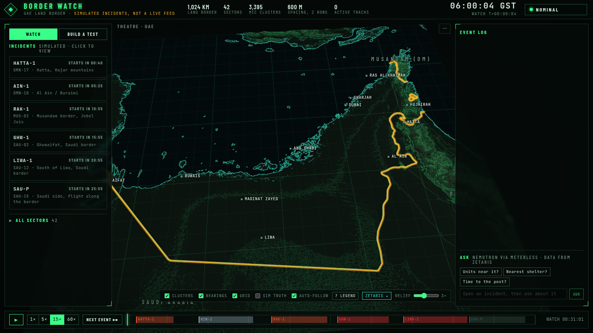
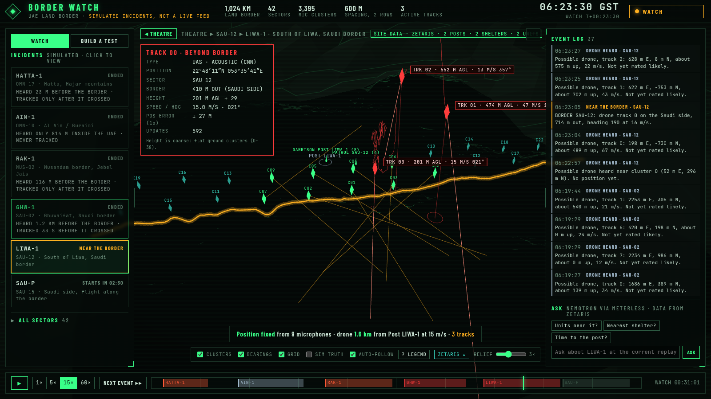
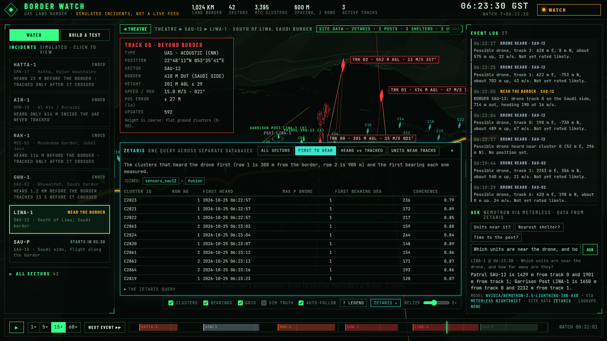
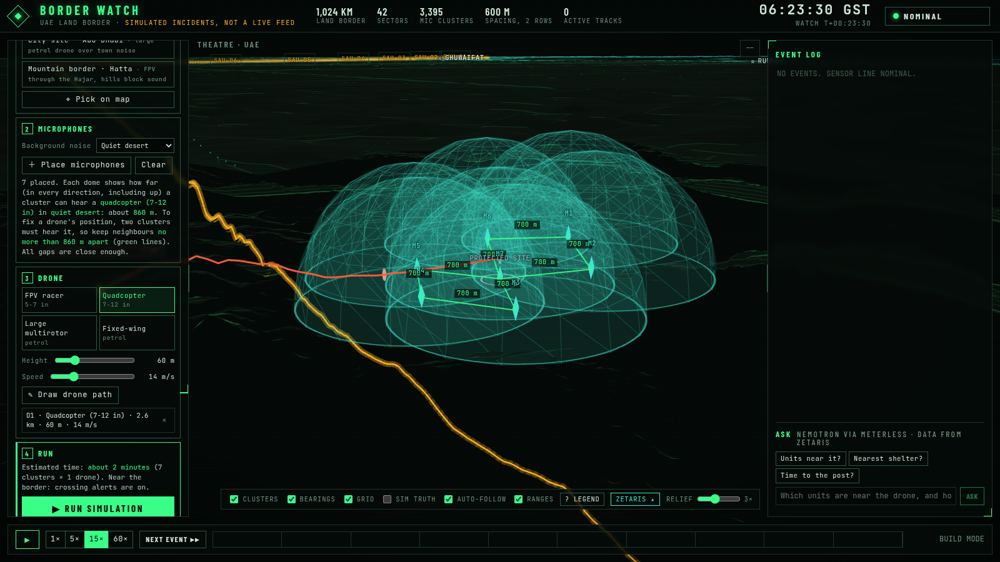
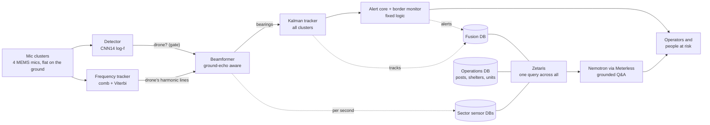

# Acoustic drone detection and tracking (audiodrone)

**Small drones are hard to see on radar and cameras, but they are loud.** Their sound is a set of evenly spaced tones from the rotors or engine. This project detects, locates and tracks drones **by ear**:
- **Clusters of four microphones on the ground** each listen for drone sound and measure its direction.
- **A tracker** fuses the directions from many clusters into positions, heights and speeds.
- **A fixed-logic alert layer** warns the people at risk.
- **Data and operators:** **Zetaris** federates the stored sensor, tracking and operations data, and **Nemotron (through Meterless Nightshift)** answers operators' questions from it.

It is shown on **Border watch**, a tactical 3D screen of the UAE's 1,024 km land border. There you can replay simulated incidents, or **build your own test**: place microphones, draw a drone's path, and run the whole chain on simulated sound over real terrain.

> Everything shown is **simulation run through the real software**. The detector is trained on simulated sound only, and tested on real recordings. A field test with a real drone is the next step.

| The whole border, 3,395 microphone clusters | An incident: bearings, tracks, the track card |
|---|---|
|  |  |
| **Zetaris query across 7 databases, and a Nemotron answer via Meterless** | **Build mode: 3D listening domes, a drone path** |
|  |  |

## Techniques at a glance

Each row links to the details in **[docs/TECHNIQUES.md](docs/TECHNIQUES.md)**: the problem, the method and its maths, the code, the tests, and the measured results.

| Technique | What it does | Code | Evidence |
|---|---|---|---|
| [Physics-based acoustic simulator](docs/TECHNIQUES.md#1-physics-based-acoustic-scene-simulator) | Rotor and engine sound models, exact emission-time propagation (so Doppler is physical), ISO 9613-1 air absorption, ground echo, confusers; labels by tonal audibility | `sim/` | 6,400 deterministic scenes; renders verified bit-identical |
| [Transfer-learned detector](docs/TECHNIQUES.md#2-transfer-learned-drone-detector) | AudioSet-pretrained **CNN14**, fine-tuned with a **log-frequency front end**, 3 classes every 10 ms | `cnn/` | Validation F1 **0.914**; **real** drones detected out to about 100 m |
| [Harmonic frequency tracker](docs/TECHNIQUES.md#3-harmonic-frequency-tracker) | Whitened comb score with a gap penalty, Viterbi path with a no-tone state, second tone by notching | `loc/freqtrack.py` | Tone locked in **73 %** of audible frames; **0.15 %** pitch error |
| [Echo-aware, tone-guided beamforming](docs/TECHNIQUES.md#4-ground-echo-aware-tone-guided-beamforming) | Steering vector that includes the ground echo; listens only on the drone's own harmonics (GPU, torch) | `loc/doa.py` | Median direction error 13.7° → **5.3°** (**3.0°** up to 2 kHz); **real** array **8.5°** |
| [Multi-cluster Kalman tracker](docs/TECHNIQUES.md#5-multi-cluster-extended-kalman-tracker) | Extended Kalman filter with emission-time correction; **ghost suppression** (three-ray births, a height cap, swarm-safe merging) | `loc/track.py` | Ghost tracks cut **80–95 %**; swarm test keeps drones 70 m apart separate |
| [Terrain acoustics](docs/TECHNIQUES.md#6-terrain-acoustics-on-real-elevation-data) | Copernicus elevation, **ITU-R P.526** knife-edge diffraction, echo off the local slope | `terra/dem.py`, `terra/scenario.py` | Hills blocking sound measured per cluster |
| [Fixed-logic alerting](docs/TECHNIQUES.md#7-fixed-logic-alerting) | Rating, a probabilistic danger zone (non-central χ²), alert tiers, a **border monitor** | `alerting/` | Two-stroke drones heard **1–1.4 km before the border** and tracked before crossing |
| [**Zetaris** data federation](docs/TECHNIQUES.md#8-data-federation-with-zetaris) | 8 separate databases (per-sector sensors, fusion, operations) joined by single Lightning SQL queries; site data over MCP | `terra/federated.py`, `scripts/sensor_stores.py` | Queries take about 1 s; the SQL is shown on screen |
| [**Nemotron** via **Meterless**](docs/TECHNIQUES.md#9-nemotron-through-meterless-nightshift) | Operator Q&A grounded in Zetaris data; every number, unit and name checked; deadlines and fallbacks | `alerting/agent.py`, `terra/ask.py` | Answers in 3–6 s; unsupported claims flagged |
| [Listening-range model and build mode](docs/TECHNIQUES.md#10-listening-range-model-and-build-mode) | How far each cluster hears each drone type, fitted to the full simulation; 3D domes; one-click runs | `terra/build.py` | Quad: **860 m** in desert, **170 m** in town |
| [Live input](docs/TECHNIQUES.md#11-live-input-for-field-tests) | Sound card or replay in real time; streaming polyphase resampling; always records | `live/run.py` | 0.19 s per update against a 0.5 s budget |

## How it fits together



The live loop (microphone to alert) runs at 10 Hz and never waits on Zetaris or the language model. Zetaris joins the stored data; Nemotron only words answers, and every number it gives is checked. Full map: **[ARCHITECTURE.md](ARCHITECTURE.md)**. Design reasoning and decisions: **[design.md](design.md)**.

## Sponsor technology: how each is used

| | Role | Where |
|---|---|---|
| **Zetaris** | Runs locally in Docker and federates eight separate Postgres stores (six per-sector sensor stores, fusion, operations) as data sources. Cross-store questions ("which clusters heard it first, and from what bearing", "units near the tracks") are single Lightning SQL queries over JDBC. It also backs the site-data MCP server the language model uses | `scripts/sensor_stores.py`, `scripts/border_ops.py`, `terra/federated.py`, `alerting/sitedata_zetaris.py`, `deploy/zetaris/` |
| **Meterless Nightshift** | The model gateway: every language-model call goes through Nightshift's OpenAI-compatible API, reached over an SSH tunnel to the GPU PC | `alerting/config.py`, `terra/ask.py` |
| **Nemotron** | **Nemotron 3.5 Lightning** answers operator questions and writes follow-up alert messages. Nemotron Mini runs locally as the fallback | `alerting/agent.py` |

## Results at a glance (simulation unless marked real)

- **Detector:** validation F1 0.914. **Real:** drones detected out to about 100 m. Weakness: false alarms on everyday sounds.
- **Directions:** 5.3° median with the frequency tracker's guidance. **Real** array: 8.5° azimuth against GPS.
- **Border incidents:** two-stroke drones were heard 1–1.4 km out and tracked before crossing. A quiet electric drone was heard only at the line in the Hajar mountains, and only past it in town noise.
- **Ghost tracks:** extra tracks fell 3.5 → 0.16 (two-drone test) and 8.7 → 1.3 (Liwa).

**Open limits, stated plainly:**
- **Two drones close together:** heard by the same clusters, they show as one, because each cluster reports one direction. That is the next fix (design Q40).
- **Height** is coarse with flat ground clusters.
- **No field test with a real drone yet.**

## Run it

```bash
bash scripts/setup.sh                               # Python env + model weights ("setup OK")
.venv/bin/pip install -r requirements-alerting.txt -r requirements-terra.txt
bash scripts/get_dem_uae.sh                         # UAE elevation tiles (~870 MB)
bash scripts/demo_check.sh --start                  # starts the screen server, checks Zetaris / Meterless / Nemotron
# open http://127.0.0.1:8790  → WATCH (incidents) or BUILD A TEST (place mics, draw a drone, Run)
.venv/bin/python -m pytest -q                       # 70 tests
```

Border watch works without Zetaris and Nemotron. The ZETARIS drawer and the Ask box use them when they are set up: [docs/REPLICATION.md section 10](docs/REPLICATION.md#10-border-watch-zetaris-and-nemotron) and [AGENTS.md](AGENTS.md) steps 9–11. A 3-minute demo script is in [docs/DEMO.md](docs/DEMO.md).

## Repository map

| Path | What |
|---|---|
| `sim/` | Acoustic scene simulator: sources, propagation, labels, renderer |
| `cnn/` | Detector: CNN14 with a log-frequency front end, training, evaluation, inference |
| `loc/` | Frequency tracker, beamformer, Kalman tracker, evaluation |
| `terra/` | Terrain, the chain on terrain, Border watch (server and `static/`), build mode, Zetaris queries, Ask |
| `alerting/` | Rating, danger zone, alert core, border monitor, delivery, Nemotron layer, site data (MCP, Zetaris) |
| `live/` | Real-time microphone input for field tests |
| `scripts/` | Data generation, studies, store loading, demo check |
| `tests/` | 70 tests |
| `results/` | Measured results with READMEs: `freqtrack/`, `chain_v2/`, `spacing/`, `swarm_abudhabi/`, `real_world/`, `loc_v1/`, per model |
| `docs/` | **[TECHNIQUES.md](docs/TECHNIQUES.md)**, [REPLICATION.md](docs/REPLICATION.md) (full setup, data, training, every tool), [DEMO.md](docs/DEMO.md), [NEXT_STEPS.md](docs/NEXT_STEPS.md), [UPGRADES.md](docs/UPGRADES.md) |
| `ARCHITECTURE.md`, `design.md`, `AGENTS.md` | System map; design and decisions (D-xx) with maths; step-by-step setup and checks |

Licences and data sources (PANNs, Copernicus, Natural Earth, the real-recording datasets) are listed in [docs/REPLICATION.md](docs/REPLICATION.md#licences).
