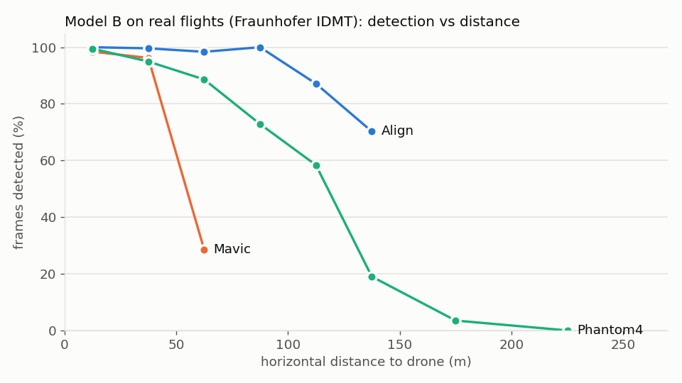
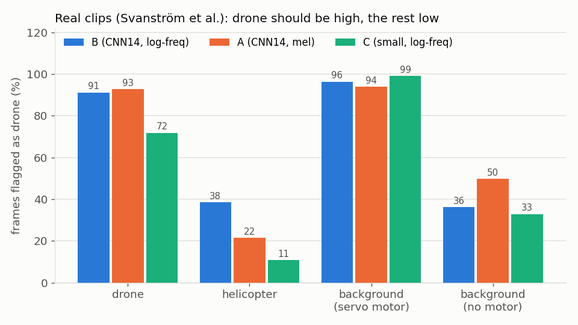

# Real-recording tests (2026-10-23)

The three published models (B, A, C from release models-v0.5) were trained on simulated audio only. These tests run them on public real recordings to see what carries over. **Real audio is used here for testing only, never training** (design D-25). No audio is stored in this repo; the scripts download nothing and expect the datasets under `data/real/`.

## Datasets

| Dataset | What | Licence | Used for |
|---|---|---|---|
| [Fraunhofer IDMT drone flights](https://zenodo.org/records/17525811) (`MicArrayData30s`) | 163 × 30 s outdoor segments (1.36 h) of a DJI Phantom 4, DJI Mavic and an Align drone (Berne, Germany, Aug 2022); 8-channel 48 kHz array (channel 0 used); GPS positions give horizontal distance | CC BY 4.0 | Detection vs distance |
| [Svanström et al. 2021 drone detection dataset](https://doi.org/10.5281/zenodo.5500576) (`Data/Audio`) | 90 × 10 s clips from a ground directional mic (Boya BY-MM1), 44.1 kHz: 30 drone (Hubsan H107D+, DJI Phantom 4 Pro, DJI Flame Wheel F450), 30 helicopter, 30 background | CC0 1.0 | Detection, real helicopters, real outdoor background |
| [ESC-50](https://github.com/karolpiczak/ESC-50) | 2,000 × 5 s clips, 50 environmental classes, no drones | CC BY-NC 3.0 (internal testing only) | False alarms on everyday sounds |

Considered and not used:
- DroneAudioSet (MIT): microphones on the drone itself, recorded indoors; not a ground-observer setup.
- Al-Emadi DroneAudioDataset: its licence forbids security and surveillance use.

## Results

"Flagged" means drone_electric or drone_engine ≥ threshold. An "event" is ≥ 0.5 s continuously above threshold, which is what `cnn.infer` reports.

### 1. Real drones are detected out to ~100–150 m



Model B, any-drone flagged frames, threshold 0.5 (full table: `idmt_by_range.csv`):

| Horizontal distance | 0–25 m | 25–50 m | 50–100 m | 100–150 m | 150–200 m | > 200 m |
|---|---|---|---|---|---|---|
| All flights | 99 % | 96 % | 82 % | 54 % | 3 % | 0 % |
| Phantom 4 | 99 % | 95 % | 80 % | 51 % | 3 % | 0 % |
| Mavic (smaller) | 98 % | 96 % | 29 % | n/a | n/a | n/a |
| Align | 100 % | 100 % | 99 % | 80 % | n/a | n/a |

- A (mel) is about the same at threshold 0.5. At 0.7, B holds up better: 97 vs 89 % within 25 m and 93 vs 89 % at 25–50 m.
- At > 200 m it flags 0 % of frames. On that site's background with the drone out of earshot, it stays quiet.
- In the earlier analysis (design.md 5.10.2), B also beat A on the hovering Phantom 4 (0.94 vs 0.77 frame recall).

### 2. Ground-mic clips: drones yes, but the background fires too



| Clips | n | B frames flagged | B clips with an event | A frames | C frames |
|---|---|---|---|---|---|
| Drone | 30 | **91 %** | **100 %** | 93 % | 72 % |
| Helicopter | 30 | 38 % | 67 % | 22 % | 11 % |
| Background with servo-motor whine | 7 | 96 % | 100 % | 94 % | 99 % |
| Background, no motor | 23 | **36 %** | **87 %** | 50 % | 33 % |

- **Servo backgrounds:** 7 of the background clips contain the whine of the camera mount's pan/tilt servos. That is a real electric-motor harmonic comb, the same physics as a drone. Flagging it is arguably correct, and the downstream tracker (no motion, no Doppler) would have to reject it.
- **Clip-level separation**, scored by mean drone probability per clip (AUC):

  | Model | Drone vs background | Drone vs helicopter |
  |---|---|---|
  | B | 0.84 | 0.93 |
  | A | 0.77 | 0.98 |
  | C | 0.64 | 0.88 |

- **Electric drones called "engine":** 7 of the 30 drone clips (all electric drones) get more drone_engine than drone_electric frames from B. These are close, loud, low-fundamental clips with dense harmonics, the same failure as W6 in the sim.
- **Raising the threshold** trades detection for false alarms but doesn't fix them. With B at 0.9, drone frames fall to 65 % while no-motor background is still 12 % of frames, and 43 % of no-motor clips still have an event.

### 3. Everyday sounds trigger the electric head

ESC-50, share of clips with a drone_electric event (full table: `esc50_by_category.csv`):

| | B | A |
|---|---|---|
| All 2,000 clips | 76 % | 84 % |
| Same at −20 dB / −40 dB | 82 % / 82 % | 86 % / 84 % |

- **Worst categories:** crow, car horn, crying baby, sheep, hen, rooster, toilet flush, laughing, siren, coughing, breathing (95–100 %).
- **Best:** rain 2 %, crackling fire, sea waves and footsteps 22 % each.
- The pattern is **tonal or harmonic sound that isn't one of the simulator's negatives**. Broadband noise (rain, waves) is fine. Level doesn't matter, so it isn't a loudness effect.

## What this means

1. **The physics transfers.** A sim-only model finds real DJI-class drones out to ~100 m, with no real training data. That validates the simulator's drone sound.
2. **The negatives don't transfer.** The model's idea of "not a drone" is the simulator's short list: engines, vehicles, hum, insects, birds, wind, rain. Any real harmonic sound outside that list (voices, animals, horns, sirens, motors) is treated as a drone. In a field deployment this would mean false alarms every few minutes.
3. **B is still the best model to carry forward:** best drone-vs-background separation and the best real detection at a usable threshold. A is better on helicopters only. C is too weak on real drones (72 %).

## Suggestions to improve the model

In order of expected gain. The full ranked list with sim evidence is in [../../UPGRADES.md](../../UPGRADES.md).

1. **Train on far more varied negatives** (biggest gain; needs the D-25 / open question 21 decision).
   - Option A, real negatives only: mix licence-clean real non-drone clips into training scenes as backgrounds and as confusers, labelled negative for all heads. Candidates: FSD50K CC0/CC BY clips covering voices, animals, alarms, horns, household, machinery. Keep ESC-50 and Svanström out of training so they stay honest tests.
   - Option B, sim only: add synthetic harmonic negatives with the right *statistics* but not drone structure, e.g. vibrato voices and calls, two-tone sirens, horn stacks, animal-call formants. This is cheaper on licences, but riskier: the model may learn the synthesiser instead.
   - **Target:** ESC-50 event rate < 10 % and no-motor Svanström background < 10 % of frames, with IDMT within 50 m staying ≥ 95 %.
2. **Use the real tests as a release gate.** Run `analysis/real.py` (all three datasets) on every new checkpoint and report it next to the sim F1. Ship nothing that regresses.
3. **Add motor-but-not-drone negatives.** Servos, fans, drills, electric scooters, model cars. These share the electric-motor comb but don't fly. Either label them negative, or accept that the CNN flags them and leave the motion and Doppler checks downstream to reject stationary ones. Write the choice down as a design decision.
4. **Fix "electric called engine".** Widen the mid/large electric class to low tip speeds, 2-blade large props and close passes with dense harmonics. For detection only, use "any drone" = max of the two drone heads, so a class mix-up is not a miss.
5. **Recording-chain augmentation:** codec round trips, high-pass 50–500 Hz, low-pass, preamp noise, mic tilt. The Svanström mic is a cheap directional mic, and B already lost 0.15–0.2 F1 to MP3 and high-pass in the sim robustness test.
6. **Calibrate the thresholds** on validation data (≈ 0.7 for the drone heads). This is cheap and reduces false alarms a little, but on its own it does not fix #1.
7. **Add a temporal consistency step after the CNN.** Require the detection to persist (e.g. ≥ 2 s), and require its harmonic comb to move with Doppler. Animal calls and voices are short and erratic; a drone pass is long and smooth. This is design work for the comb trigger and frequency tracker, not the CNN.
8. **Field test**, with the same metrics as this page:
   - uncompressed WAV;
   - flights logged with GPS;
   - drone-free recordings at the same site with people, birds and traffic.

## Reproduce

```bash
# data (not in git): put the datasets under data/real/
#   data/real/idmt/MicArrayData30s/...     data/real/svanstrom/audio/*.wav     data/real/ESC-50-master/...
.venv/bin/python -m analysis.real idmt      --root data/real/idmt          --out analysis/out/real_idmt.pkl
.venv/bin/python -m analysis.real svanstrom --root data/real/svanstrom     --out analysis/out/real_svanstrom.pkl
.venv/bin/python -m analysis.real esc50     --root data/real/ESC-50-master --out analysis/out/real_esc50.pkl
.venv/bin/python -m analysis.figures --out results/real_world
```

The servo-motor background clips were identified by inspecting spectrograms: BACKGROUND_001, 006, 011, 013, 021, 022, 026.
